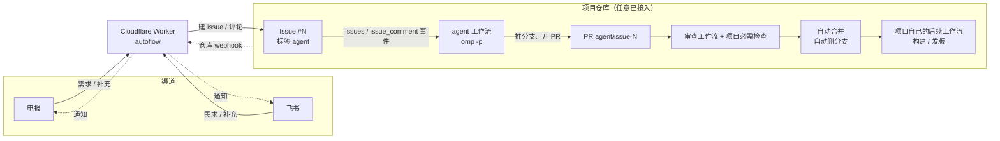
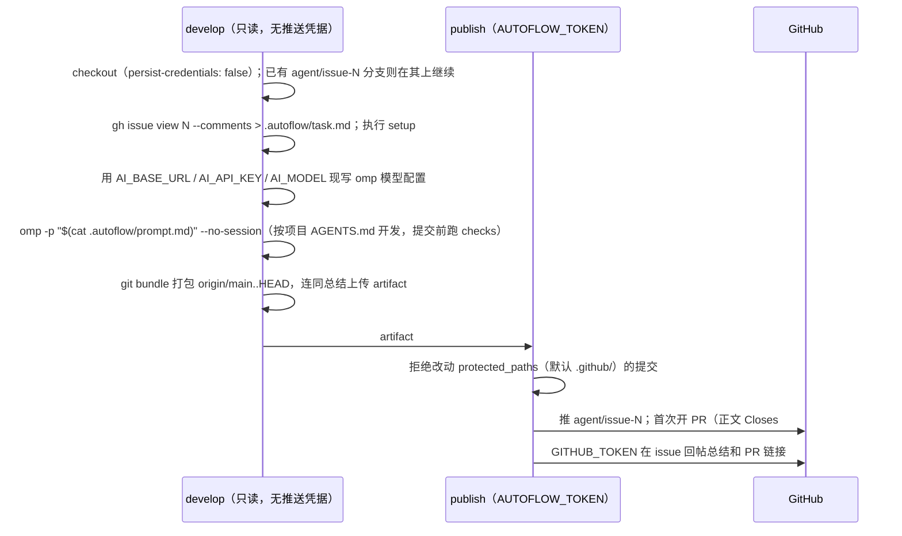

# AutoFlow 方案设计

> 2026-10-23 定稿。AutoFlow 是一个通用框架：在电报或飞书里给任意已接入的 GitHub 仓库提需求，omp 在 GitHub Actions 里完成开发并开 PR，模型审查通过、项目的必需检查全绿后自动合并，全程无人工。框架止于合并；构建、打包、发版由各项目自己的工作流负责。

## 1. 已确定的决策

| 项         | 决定                                                                                            |
| ---------- | ----------------------------------------------------------------------------------------------- |
| Agent      | omp，非交互运行（`omp -p`、`--no-session`）                                                     |
| 消息渠道   | 电报和飞书都接，两者都能下需求、收通知                                                          |
| 桥         | Cloudflare Worker `autoflow`，一个 Worker 服务所有已接入仓库                                    |
| 任务载体   | 项目仓库里的 GitHub Issue（标签 `agent`），需求、对话、关联 PR 都记录在 issue 上                |
| 接入方式   | AutoFlow 提供可复用工作流（reusable workflow），项目仓库只放两个十来行的调用文件                |
| 仓库可见性 | 面向公开仓库：需求文本、agent 输出和 Actions 日志所有人可见；私有仓库也能用，Actions 按分钟计费 |
| 通知       | 收到需求、开出 PR、审查打回、已合并、agent 运行失败；项目指定的工作流（如发版）成功时广播       |
| 暂不做     | 一个需求跨多个仓库改动；审查打回后自动重试（打回后在聊天里补充，agent 在同一 PR 上继续改）      |

## 2. 组成与流程

| 组件         | 位置                                                             | 作用                                               |
| ------------ | ---------------------------------------------------------------- | -------------------------------------------------- |
| Worker       | `AutoFlow/src/worker/`                                           | 聊天消息 → issue / 评论；GitHub webhook → 聊天通知 |
| agent 工作流 | `AutoFlow/.github/workflows/agent.yml`（可复用）                 | 读取 issue，omp 开发，推分支并开 PR                |
| 审查工作流   | `AutoFlow/.github/workflows/review.yml`（可复用）+ `src/review/` | 模型审查 PR，通过后开启自动合并                    |
| 接入模板     | `AutoFlow/templates/`                                            | 复制到项目仓库 `.github/workflows/` 的两个调用文件 |



## 3. 与 msgflow 的差异

参考 [ohwiki/msgflow](https://github.com/ohwiki/msgflow)：沿用"Worker 只做转发、耗时任务交给 Actions"的结构，以下几处不照搬。

| msgflow 做法                                                      | 问题                                            | AutoFlow 做法                                            |
| ----------------------------------------------------------------- | ----------------------------------------------- | -------------------------------------------------------- |
| `workflow_dispatch` 传参，消息直接插进 shell（`-m "${{ ... }}"`） | 消息里带 `"` 或 `$( )` 就能在虚拟机执行任意命令 | 需求写进 issue，工作流从文件读取，不做表达式插值         |
| 按输入的 `callback_url` 推导地址，把 `CALLBACK_SECRET` 发过去     | 能触发 dispatch 的人改个地址就能拿到密钥        | 不要回调；通知走仓库 webhook，Worker 用 HMAC 验签        |
| 结果直接 `git push` 到 main                                       | 没有审查，和分支保护冲突                        | 推 `agent/issue-N` 分支开 PR，经模型审查和必需检查后合并 |
| 任务只存在于 dispatch 参数里                                      | 失败无记录，无法重试，看不到历史                | issue 即任务记录；重打标签或补一条评论即可重跑           |
| 一个部署对应一个仓库                                              | 每个项目要各部署一套                            | 一个 Worker 服务多个仓库，项目只需复制调用文件和配置     |

## 4. Worker（Cloudflare，`autoflow`）

只做三件事：聊天消息转成 issue 或评论；GitHub webhook 转成通知；回复简单命令。不调用模型，不保存需求内容。

| 路由             | 来源         | 入站验证                                                                                                      |
| ---------------- | ------------ | ------------------------------------------------------------------------------------------------------------- |
| `POST /telegram` | 电报 bot     | `X-Telegram-Bot-Api-Secret-Token` 等于 `TELEGRAM_WEBHOOK_SECRET`；发送者 id 在白名单内                        |
| `POST /feishu`   | 飞书事件     | 首次 `url_verification` 回显 challenge；按 Encrypt Key 解密并验签；发送者 open_id 在白名单内；`event_id` 去重 |
| `POST /github`   | 仓库 webhook | `X-Hub-Signature-256` 用 `GITHUB_WEBHOOK_SECRET` 做 HMAC-SHA256 校验，常数时间比较；仓库必须在 `REPOS` 内     |

不在白名单的发送者一律静默丢弃，不回复，避免暴露 bot 存在。

**聊天里的用法**

| 发送内容                                                 | 动作                                                                                         |
| -------------------------------------------------------- | -------------------------------------------------------------------------------------------- |
| `/repos`                                                 | 列出已接入仓库的别名                                                                         |
| `/use <别名>`                                            | 设置当前会话的默认仓库                                                                       |
| 任意文本，或 `@<别名> 文本`                              | 在默认仓库（或指定仓库）新建 issue：标题取首行（≤ 80 字），正文为全文加来源，带 `agent` 标签 |
| `#12 补充`、`<别名>#12 补充`，或回复带 `#12` 的 bot 消息 | 在对应 issue 下发评论，agent 在同一分支上继续改                                              |
| `/help`                                                  | 返回用法                                                                                     |

**通知映射**（来自 GitHub webhook）

| 事件                                                                       | 通知内容                  | 发给           |
| -------------------------------------------------------------------------- | ------------------------- | -------------- |
| Worker 建好 issue                                                          | 收到需求 别名#N + 链接    | 来源会话       |
| `pull_request.opened`，分支 `agent/issue-N`                                | 已开 PR + 链接            | issue 的会话   |
| `issue_comment.created`，PR 上以 `AI review (...): changes requested` 开头 | 审查打回 + 意见摘要       | issue 的会话   |
| `pull_request.closed` 且 `merged`，分支 `agent/issue-N`                    | 已合并                    | issue 的会话   |
| `workflow_run.completed`，agent 工作流失败                                 | agent 运行失败 + 日志链接 | issue 的会话   |
| `workflow_run.completed` 成功，工作流名在该仓库的 `announce` 列表里        | 工作流名 + 结论 + 链接    | 所有白名单会话 |

**配置**（`wrangler secret` / `vars`）

| 名称                                                                                  | 说明                                                                                            |
| ------------------------------------------------------------------------------------- | ----------------------------------------------------------------------------------------------- |
| `REPOS`（var，JSON）                                                                  | `{"<别名>": {"repo": "owner/name", "announce": ["Release"]}}`；接入新仓库只改这里               |
| `GITHUB_TOKEN`                                                                        | 细粒度 PAT，只对 `REPOS` 里的仓库有 Issues 读写；碰不到代码和 Actions                           |
| `GITHUB_WEBHOOK_SECRET`                                                               | 所有接入仓库的 webhook 共用                                                                     |
| `TELEGRAM_BOT_TOKEN`、`TELEGRAM_WEBHOOK_SECRET`、`TELEGRAM_ALLOWED_USER_IDS`          | 电报 bot；`setWebhook` 时带 `secret_token`                                                      |
| `FEISHU_APP_ID`、`FEISHU_APP_SECRET`、`FEISHU_ENCRYPT_KEY`、`FEISHU_ALLOWED_OPEN_IDS` | 飞书自建应用，订阅 `im.message.receive_v1`；tenant token 缓存 2 小时                            |
| KV `AUTOFLOW`                                                                         | `chat:<渠道:id> → 默认别名`；`issue:<owner/name>#N → {渠道, chatId}`；飞书事件去重和 token 缓存 |

分支名 `agent/issue-N` 反查 issue，不再另存。

## 5. agent 工作流（可复用）

项目仓库的调用文件只负责触发和传参：

```yaml
# 项目仓库 .github/workflows/autoflow-agent.yml
on:
  issues: { types: [labeled] }
  issue_comment: { types: [created] }
jobs:
  agent:
    uses: ouraihub/AutoFlow/.github/workflows/agent.yml@<tag 或 commit>
    with:
      setup: pnpm install --frozen-lockfile # 安装依赖
      checks: pnpm test # agent 提交前必须通过的快速检查
    secrets: inherit
```

**触发条件**（在可复用工作流内判断）

- `issues.labeled`：标签为 `agent`，且 `sender.login == repository_owner`。公开仓库任何人都能开 issue，但只有协作者能打标签。
- `issue_comment.created`：issue 带 `agent` 标签、不是 PR（`!issue.pull_request`），且 `comment.author_association == 'OWNER'`。
- Worker 用 owner 的 PAT 建 issue 和评论，满足上面两条。agent 回帖用 `GITHUB_TOKEN`，作者是 `github-actions[bot]`，不会再次触发。
- `concurrency: autoflow-<repo>-<N>`：同一 issue 排队，不取消正在运行的任务。

**两个 job，权限分开**



- 需求只通过文件进入 omp，`$(cat ...)` 的结果不会被 shell 再次解析；任何地方都不出现 `${{ github.event.issue.body }}` 这类插值。
- `develop` 只持有模型密钥，没有任何 GitHub 写权限，即使被需求内容诱导也推不了代码。`publish` 不执行仓库代码，只搬运提交。
- agent 不能改 `protected_paths`：CI 和审查规则不由 agent 自己改。
- 没有产生提交时，只回帖说明原因，不开 PR。`timeout-minutes` 默认 120，可由输入覆盖。

| 输入              | 默认           | 说明                                        |
| ----------------- | -------------- | ------------------------------------------- |
| `setup`           | 空             | 安装依赖等准备命令                          |
| `checks`          | 空             | agent 提交前必须通过的命令；完整检查交给 PR |
| `protected_paths` | `.github/`     | agent 提交不得触碰的路径前缀，逗号分隔      |
| `runs-on`         | `ubuntu-24.04` | 需要其他系统时覆盖                          |
| `timeout`         | `120`          | 分钟                                        |

## 6. 审查工作流（可复用）

完整调用文件见 `templates/autoflow-review.yml`，核心部分：

```yaml
jobs:
  autoflow:
    uses: ouraihub/AutoFlow/.github/workflows/review.yml@<tag 或 commit>
    with:
      model: ${{ vars.AI_MODEL }}
    secrets:
      AI_BASE_URL: ${{ secrets.AI_BASE_URL }}
      AI_API_KEY: ${{ secrets.AI_API_KEY }}
      AUTOFLOW_TOKEN: ${{ secrets.AUTOFLOW_TOKEN }}
```

- 必需检查的名称是 `autoflow / AI review`（调用 job 名 / 可复用 job 名）。
- 可复用工作流按 `job.workflow_repository` 和 `job.workflow_sha` checkout AutoFlow 自身，所以审查代码与项目固定的版本完全一致。
- secrets 逐个显式传入，不用 `secrets: inherit`，项目的其他 secret 不会暴露给 AutoFlow。

- 用 `pull_request_target`：调用文件和审查脚本都取自默认分支与固定的 AutoFlow 版本，PR 改不了自己的审查。PR 代码只作为 diff 文本读取，不 checkout、不执行。
- 模型输入：PR 标题、正文、diff、项目根目录 `AGENTS.md`。要求只返回 `{"verdict":"approve"|"request_changes","issues":[...]}`。
- 由脚本决定结果，模型不执行任何操作。从严的情况：结论无法解析、带问题的 approve、diff 超过上限、改动 `protected_paths` 时要求权限不得放宽、来自 fork 的 PR。
- 结论写成 PR 评论，开头固定为 `AI review (<模型>): approved.` 或 `changes requested.`，Worker 据此发打回通知。
- 通过后用 `AUTOFLOW_TOKEN` 执行 `gh pr merge --auto --merge`。必须用 PAT：`GITHUB_TOKEN` 做的合并不会触发项目在默认分支上的后续工作流。
- 中转地址有没有 `/v1` 都可以，脚本缺少时自动补上。
- 中转超时或报错时检查失败，不会自动重试；重新打开 PR 或推一个新提交即可重跑。

agent 开的 PR 和人开的 PR 走同一道审查，所以项目里所有改动都可以用这个工作流把关。

## 7. 项目接入清单

| 位置           | 内容                                                                                                                            |
| -------------- | ------------------------------------------------------------------------------------------------------------------------------- |
| 工作流         | 复制 `templates/autoflow-agent.yml`、`templates/autoflow-review.yml`，填 `setup`、`checks`                                      |
| Secrets        | `AI_BASE_URL`、`AI_API_KEY`（只给 CI 用，设额度上限）、`AUTOFLOW_TOKEN`（细粒度 PAT：本仓库 Contents、Pull requests 读写）      |
| Variables      | `AI_MODEL`                                                                                                                      |
| 仓库设置       | 允许自动合并；合并后自动删除分支；建 `agent` 标签                                                                               |
| 分支保护       | 默认分支禁止直推和强推；必需检查 = 项目自己的检查 + `autoflow / AI review`；PR 上的必需检查不能按路径过滤，否则会一直等待       |
| Webhook        | 地址 `https://<worker>/github`，JSON，共享 `GITHUB_WEBHOOK_SECRET`；事件选 Issues、Issue comments、Pull requests、Workflow runs |
| `AGENTS.md`    | 项目自己的开发规则，agent 和审查都读它。若规则要求推送前跑完整 CI，需注明 agent 只跑 `checks`，完整检查由 PR 必需检查完成       |
| Worker `REPOS` | 加一条别名，按需填 `announce`（例如发版工作流名）                                                                               |

合并方式建议只开"合并提交"：用 conventional commits 生成 CHANGELOG 的项目，squash 会把多条提交压成一条。

## 8. 安全边界

| 风险                             | 措施                                                                                               |
| -------------------------------- | -------------------------------------------------------------------------------------------------- |
| 陌生人通过聊天下需求             | Worker 白名单 + 各渠道签名或密钥校验；不在白名单静默丢弃                                           |
| 陌生人在公开仓库开 issue         | 只有 owner 打标签或评论才触发                                                                      |
| 需求文本注入 shell               | 只经文件传给 omp，不做表达式插值                                                                   |
| agent 被诱导改 CI 或直推默认分支 | develop 无写凭据；publish 拒绝 `protected_paths`；分支保护 + 审查 + 必需检查                       |
| PR 改掉自己的审查                | `pull_request_target` 从默认分支和固定 AutoFlow 版本取工作流；`AI review` 是必需检查，删掉也合不了 |
| 审查被 diff 里的文字诱导         | 只认固定格式结论；改 `protected_paths` 从严；模型不直接执行操作                                    |
| agent 泄露模型密钥               | 无法完全防住（agent 能执行任意命令）。用只给 CI 的 key 并设额度上限，泄露后在中转作废重设          |
| Worker 被伪造 GitHub 通知        | `X-Hub-Signature-256` HMAC 校验；仓库不在 `REPOS` 内直接丢弃                                       |
| Worker 的 GitHub token 泄露      | 细粒度 PAT 只有 Issues 读写，最多能建 issue 和评论                                                 |
| AutoFlow 自身被改坏或投毒        | 项目按 tag 或 commit 引用 AutoFlow，不跟随 `main`；升级是项目里一次可审查的改动                    |

公开仓库意味着需求文本、agent 输出和 Actions 日志全部公开。不要在需求里写密钥或私人信息。

## 9. 项目结构

```
AutoFlow/
├── docs/01-方案设计.md
├── AGENTS.md                 # 工程规范，审查也读它
├── src/
│   ├── core/                 # 共享：errors.ts、log.ts、guard.ts
│   ├── review/               # ports.ts（接口）、reviewer.ts（服务）、适配器、main.ts（组合根）
│   ├── agent/                # 第 2 步
│   └── worker/               # 第 4 步：Cloudflare Worker，index.ts、channels/、github/
├── .github/workflows/
│   ├── review.yml            # 可复用：模型审查 + 自动合并
│   ├── agent.yml             # 可复用：develop + publish（第 2 步）
│   └── ci.yml                # AutoFlow 自身的检查
└── templates/
    ├── autoflow-review.yml   # 复制到项目仓库
    └── autoflow-agent.yml    # 第 2 步
```

- 全部 TypeScript，严格 `tsconfig`，只用可擦除语法；Node（≥ 24）直接运行 `.ts`，Actions 里不编译、不装依赖。Worker 由 wrangler 打包。
- 每个功能在 `ports.ts` 里定义对外依赖的接口，适配器类实现接口，服务类经构造函数注入；只有 `main.ts` 读 env、组装依赖。
- 错误统一用带 `code` 的 `AutoFlowError`，日志统一用注入的 JSON `Logger`。细则见 `AGENTS.md`。
- 依赖只用最新正式版并锁定精确版本。typescript-eslint 当前最新版不支持 TypeScript 7，因此不引入 ESLint，质量门是严格 `tsc` + 测试 + Prettier。

## 10. 实施顺序

先用一个专门的演示仓库验收，不在真实项目上试错。每一步都有可观察的结果，通过后再进入下一步。

| 步骤 | 内容                             | 验收                                                                               |
| ---- | -------------------------------- | ---------------------------------------------------------------------------------- |
| 1    | 审查工作流 + 演示仓库接入        | 演示仓库的 PR 收到模型结论；通过且必需检查全绿后自动合并，分支自动删除             |
| 2    | agent 工作流                     | 在 GitHub 上手动开 issue 打标签，产生 PR 并走完第 1 步的流程，issue 自动关闭       |
| 3    | 补充评论续改                     | 同一 issue 评论后，agent 在同一分支追加提交，PR 重新审查                           |
| 4    | Worker + 电报                    | 电报发需求生成 issue；收到"收到 / 已开 PR / 已合并"通知；`/use` 切换仓库生效       |
| 5    | 飞书                             | 同第 4 步；重复投递的事件只处理一次                                                |
| 6    | 失败、打回通知和 `announce` 广播 | 人为制造一次审查打回和一次 agent 失败，均收到通知；`announce` 工作流成功时收到广播 |

第 1 到 3 步不依赖 Worker，单独可用：手机上用 GitHub App 开 issue 即可。部署 Worker 到 Cloudflare 前需要确认。

## 11. 待核实

- omp 在 Linux 上的安装方式（包名、bun 或 npm），以及自定义 OpenAI 兼容服务的配置格式（`models.yml` 字段、`--config` 覆盖）。第 2 步实现时核实。
- omp 在 `-p` 模式下是否需要关闭交互确认，以及中断时的退出码。
- 可复用工作流里 `pull_request_target` 的上下文与权限是否与直接写在项目仓库里一致，第 1 步实测。
- 飞书事件加密的具体格式（AES-256-CBC、签名头名称），按飞书开放平台当前文档实现。
