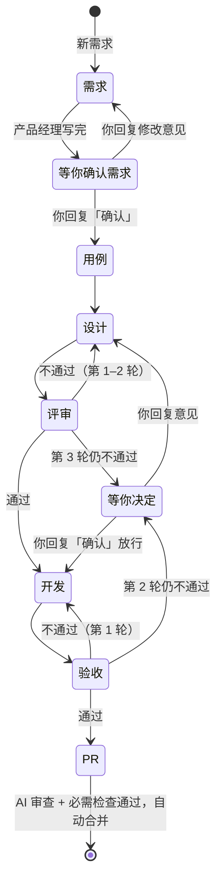

# 02 多角色开发流程

> 2026-10-24 草案，待确认。确认后替换 [01 §5](01-方案设计.md#5-agent-工作流可复用) 的"设计 → 开发"两阶段。

## 1. 目标

把一个需求拆给几个角色，每个角色只做一件事、只改自己的文档，前一步的错误由下一步的独立角色拦住：

- 需求由产品经理写清楚，你只确认"做什么"。
- 技术设计由架构师评审，不通过就打回重写，直到通过才开发。
- 测试经理只按需求写用例、做验收，不看开发过程，避免"开发自己测自己的理解"。
- 进度由程序统计和推送，不用模型。

依据（见对话中的检索）：MetaGPT 用文档交接的固定流程比 agent 互聊更连贯；AgentCoder 由独立角色写测试，通过率更高、token 更少；多 agent 失败主要来自角色间理解不一致和缺少验证（MAST）；先后顺序应由代码定死，而不是交给模型（Anthropic《Building effective agents》）。

## 2. 角色与产物

文档都在 `agent/issue-N` 分支的 `docs/issue-N/` 下。"只能改"由 publish 对推送的提交强制检查，越界改动丢弃并回帖说明（沿用现在的 `forbiddenChanges`）。

| 角色          | 读                                        | 写（只能改这些）                                                                    |
| ------------- | ----------------------------------------- | ----------------------------------------------------------------------------------- |
| 产品经理      | issue 正文和评论                          | `需求.md`：背景、用户场景、功能清单（编号 R1…）、验收标准、不做什么、待你决定       |
| 测试经理·用例 | `需求.md`                                 | `测试用例.md`：每条用例标注覆盖的 R 编号，写输入、操作、期望结果                    |
| 技术经理·设计 | `需求.md`、`测试用例.md`、代码            | `设计.md`：概要设计（模块、接口、数据）、详细设计（每个模块怎么改）、风险、任务清单 |
| 架构师        | `需求.md`、`测试用例.md`、`设计.md`、代码 | `评审.md`：每轮追加一节，逐条意见 + 结论                                            |
| 技术经理·开发 | `设计.md`、`测试用例.md`、`评审.md`、代码 | 代码和单元测试，`设计.md` 的任务勾选与进度记录                                      |
| 测试经理·验收 | `需求.md`、`测试用例.md`、成品代码        | `tests/acceptance/issue-N/`、`测试报告.md`（每轮追加）                              |
| 项目经理      | issue 标签、评论、文档勾选                | 不写文件：`/status`、阶段通知、卡住提醒，全部由程序完成                             |

开发阶段不能改 `需求.md`、`测试用例.md`、`评审.md`、`测试报告.md` 和 `tests/acceptance/`；验收阶段不能改除上面两处以外的任何文件。`protected_paths`（默认 `.github/`）所有角色都不能改。

## 3. 流程

每个方框是一次独立的 Actions 运行；中途超时或额度用完，照旧保存进度，回复「继续」从断点接着做。

## 4. 确认与评审规则

**需求**：只有你能确认，规则同现在（短回复「确认 / 可以 / ok」等算确认，其他文字算修改意见）。确认后 issue 加标签 `agent:approved`。

**技术设计**：由架构师评审代替你确认。评审标准写进架构师提示词：

- `需求.md` 的每个 R 编号、`测试用例.md` 的每条用例，设计里都有对应的实现位置；
- 符合项目 `AGENTS.md` 和现有架构，复用已有代码，没有为假想需求加的抽象；
- 风险、兼容性、数据迁移有交代；
- 结论只有「通过」「不通过」两种，有任何意见就是不通过（沿用 `src/review/verdict.ts` 的规则）。

不通过时，技术经理新开一次运行，读 `评审.md` 的意见修改 `设计.md`，并在设计里逐条回应。

**轮次上限**：评审最多 3 轮，验收最多 2 轮。超过就停下，在聊天里发"需要你决定"，附上双方的分歧。你回复意见，流程按意见继续；回复「确认」，按当前设计放行。不设上限的风险：两个模型可能永远对不上，额度会一直消耗。

**验收**：测试经理按 `测试用例.md` 写可执行的验收测试并运行，结果写进 `测试报告.md`。不通过时，技术经理按报告修改代码，但不能改验收测试本身。

## 5. 上下文隔离

- 每个角色是一次全新的运行（`omp -p --no-session`），看不到其他角色的推理过程，只能看到仓库里的文档和代码。
- 交接只靠 `docs/issue-N/` 下的文档。每份文档都要写明关键决定和理由，没写进文档的信息不会传给下一个角色。
- 测试用例在写代码之前就定好；验收阶段只读需求、用例和成品代码，不读 `设计.md` 和开发记录。

## 6. 推进由程序决定

下一阶段由纯函数 `nextStage` 计算（替换 `src/core/phase.ts`），输入全部来自分支和 issue：

| 输入                           | 来源                                                      |
| ------------------------------ | --------------------------------------------------------- |
| 哪些文档已存在                 | `agent/issue-N` 分支                                      |
| 需求是否已确认                 | 标签 `agent:approved`                                     |
| 最近一次评审、验收的结论和轮次 | `评审.md`、`测试报告.md` 每节末行的 `结论：通过 / 不通过` |
| 任务完成度                     | `设计.md` 的任务勾选                                      |
| 最新评论是否为确认或修改意见   | issue 评论                                                |

**自动接力**：除了"等你确认需求"和"等你决定"两处，每个阶段结束后，publish 用 `AUTOFLOW_TOKEN` 执行 `gh workflow run <项目的 agent 工作流> -f issue=N` 触发下一阶段。用 `GITHUB_TOKEN` 发起的操作不会触发新的工作流，所以必须用 PAT。因此需要：

- 项目模板增加 `workflow_dispatch`（输入 `issue`）触发；
- `AUTOFLOW_TOKEN` 增加 Actions 读写权限。

同一 issue 的运行仍按 `concurrency` 排队。

## 7. 聊天通知与 /status

| 时机            | 推送内容                                                  |
| --------------- | --------------------------------------------------------- |
| 需求写完        | 需求待确认 + 功能清单摘要                                 |
| 评审不通过      | 设计评审第 k 轮不通过 + 主要意见（不用你操作）            |
| 评审通过        | 设计已通过评审，开始开发 + 设计摘要（你可以回复意见打断） |
| 验收不通过      | 验收第 k 轮不通过 + 失败用例（不用你操作）                |
| 验收通过        | 验收通过，已开 PR                                         |
| 超过轮次        | 需要你决定 + 分歧摘要                                     |
| 中途停下 / 失败 | 同现在                                                    |

`/status` 的阶段名改为：需求中 / 需求待确认 / 写用例 / 设计中 / 评审第 k 轮 / 开发中 x/y / 验收第 k 轮 / 需要你决定 / PR 审查中 / 已完成。

## 8. 成本

|          | 现在             | 新流程                                                                         |
| -------- | ---------------- | ------------------------------------------------------------------------------ |
| 运行次数 | 2（设计、开发）  | 最少 6（需求、用例、设计、评审、开发、验收）；评审每多一轮 +2，验收每多一轮 +2 |
| 时长     | demo#7 约 7 分钟 | 估计 30–50 分钟                                                                |
| token    | 1×               | 估计 3–5×                                                                      |

时长和 token 是按 demo#7、demo#11 单次运行约 5 分钟估算的，没有实测。

## 9. 改动范围

- `src/core/stage.ts`：`nextStage` 纯函数和测试，替换 `phase.ts`。
- `src/agent/`：各角色提示词，按角色划定可改路径，prepare/publish 按阶段运行、解析结论、触发下一阶段。
- `.github/workflows/agent.yml`、`templates/autoflow-agent.yml`：`workflow_dispatch`，阶段输入。
- `src/worker/`：新的通知文案，`/status` 阶段名。
- 文档：01 §4.3、§4.4、§5、§7，README。
- 一次切换，不保留旧的两阶段流程。已经在旧流程里的需求（如 demo#11）继续用演示仓库固定的 v0.2.0 版本跑完。

## 10. 实施顺序与验收

1. `nextStage` 和全部转移的单元测试，包括超轮次和强制放行。
2. 角色提示词和可改路径，本地用桩脚本验证越界拦截。
3. publish 接力和结论解析，本地冒烟。
4. Worker 通知和 `/status`。
5. 演示仓库全流程：从飞书提一个需求，确认需求后，至少要出现一次评审打回和一次验收，最后自动合并；每个阶段聊天里都收到通知，`/status` 显示的阶段正确。

## 11. 待你决定

1. 架构师评审通过后直接开发（推荐），还是还要你确认技术设计？
2. 轮次上限：评审 3 轮、验收 2 轮，可以吗？
