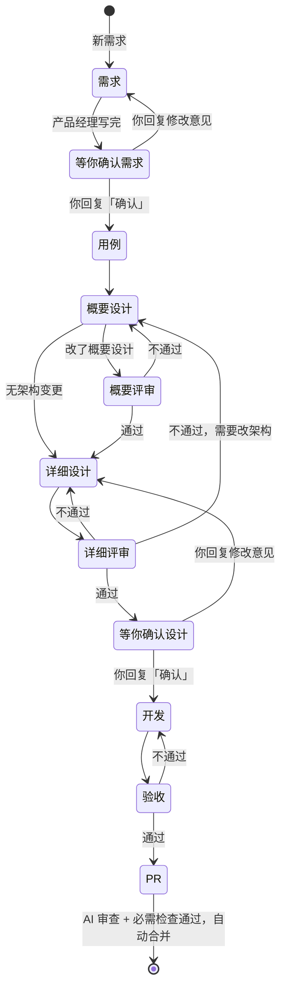

# 02 多角色开发流程

> 2026-10-24 草案，待确认。确认后替换 [01 §5](01-方案设计.md#5-agent-工作流可复用) 的"设计 → 开发"两阶段。

## 1. 目标

把一个需求拆给几个角色，每个角色只做一件事、只改自己的文档，前一步的错误由下一步的独立角色拦住：

- 需求由产品经理写清楚，你确认"做什么"。
- 概要设计和详细设计由架构师评审，不通过就打回重写；评审通过后你再确认一次技术设计，才开始开发。
- 测试经理只按需求写用例、做验收，不看开发过程，避免"开发自己测自己的理解"。
- 所有设计和代码都要满足项目的工程规范（§3），由架构师、测试经理和 PR 审查按同一份规范检查。
- 进度由程序统计和推送，不用模型。

依据（见对话中的检索）：MetaGPT 用文档交接的固定流程比 agent 互聊更连贯；AgentCoder 由独立角色写测试，通过率更高、token 更少；多 agent 失败主要来自角色间理解不一致和缺少验证（MAST）；先后顺序应由代码定死，而不是交给模型（Anthropic《Building effective agents》）。

## 2. 两层设计

|            | 概要设计                                                                                                       | 详细设计                                                                                                   |
| ---------- | -------------------------------------------------------------------------------------------------------------- | ---------------------------------------------------------------------------------------------------------- |
| 内容       | 系统架构：模块划分与依赖、技术栈与版本、数据存储、对外接口、部署运行方式、全局约定（错误处理、日志、测试方式） | 在概要设计的框架内，一个功能怎么做：改哪些模块和文件、接口与数据结构、流程、边界情况、单元测试点、任务清单 |
| 范围       | 整个项目，一份                                                                                                 | 每个需求一份                                                                                               |
| 位置       | `docs/概要设计.md`（输入 `architecture_path` 可改，已有架构文档的项目指向自己的文件）                          | `docs/issue-N/详细设计.md`                                                                                 |
| 什么时候写 | 项目还没有这份文档时创建；需求需要改架构（新模块、换技术栈、新存储或接口）时更新                               | 每个需求都写                                                                                               |
| 生命周期   | 随 PR 合并进 main，后续需求在它的基础上做                                                                      | 留在仓库里作为这个需求的记录                                                                               |

详细设计不得引入概要设计里没有的技术栈或模块；需要的话，先回到概要设计阶段修改并通过评审。

## 3. 工程规范

编程原则、日志、异常和语言最佳实践写在项目的一份规范文档里，所有角色都按它工作，评审也按它检查。规范不写进提示词：换一个项目，只换这份文档。

**位置**：`docs/工程规范.md`（输入 `standards_path` 可改）。项目根目录的 `AGENTS.md` 链接到它，所以本地开发的 agent 和人也遵守同一份。

**内容分两层**：

| 层           | 内容                             | 例子                                                                                                                                                     |
| ------------ | -------------------------------- | -------------------------------------------------------------------------------------------------------------------------------------------------------- |
| 通用约束     | 和语言无关的设计原则             | 面向接口编程，依赖经构造函数注入；模块化、组件化，模块之间只经接口通信；单一职责；日志格式与级别、不记录密钥；异常分类、只在边界捕获、不吞异常；测试要求 |
| 语言最佳实践 | 每种语言一节，项目用到哪种写哪种 | TypeScript：严格 `tsconfig`、不用 `any`、外部数据先收窄再用；Rust：`clippy` 零警告、库代码不用 `unwrap`、错误用 `thiserror` 定义；……                     |

每条规范写成可检查的句子，并尽量对应一个工具检查，例如 `tsc --strict`、`cargo clippy -D warnings`、lint 规则。模型评审容易漏，工具检查不会。能交给工具的放进项目的 `checks` 和 CI，规范里注明"由 xx 检查"。

**谁来维护**：

- 项目还没有规范时，技术经理在概要设计阶段按选定的技术栈起草，经过概要评审，再由你确认技术设计时一起确认。
- 之后修改规范，等同于修改架构：走概要设计和概要评审。
- 已经有规范的项目，比如 AutoFlow 的 `AGENTS.md`、AutoNote 的 `docs/04-工程规范.md`，把 `standards_path` 指向它，不用再写一份。

**谁来检查**：

| 环节     | 检查内容                                                                         |
| -------- | -------------------------------------------------------------------------------- |
| 概要评审 | 架构是否符合通用约束，例如面向接口、模块边界清晰；技术栈的最佳实践是否写进了规范 |
| 详细评审 | 每个模块的接口、依赖注入方式、日志和异常处理是否按规范设计                       |
| 开发     | 提交前跑 `checks`；提示词要求先读规范                                            |
| PR 审查  | 现在只读 `AGENTS.md`，改为同时读 `standards_path`，按规范逐条审代码              |
| 测试经理 | 不检查规范，只验证功能是否满足需求                                               |

## 4. 角色与产物

需求相关文档都在 `agent/issue-N` 分支的 `docs/issue-N/` 下。"只能改"由 publish 对推送的提交强制检查，越界改动丢弃并回帖说明（沿用现在的 `forbiddenChanges`）。

| 角色              | 读                                                                          | 写（只能改这些）                                                                                                          |
| ----------------- | --------------------------------------------------------------------------- | ------------------------------------------------------------------------------------------------------------------------- |
| 产品经理          | issue 正文和评论、README                                                    | `需求.md`：背景、用户场景、功能清单（编号 R1…）、验收标准、不做什么、待你决定                                             |
| 测试经理·用例     | `需求.md`                                                                   | `测试用例.md`：每条用例标注覆盖的 R 编号，写输入、操作、期望结果                                                          |
| 技术经理·概要设计 | `需求.md`、`测试用例.md`、`概要设计.md`、`工程规范.md`、代码                | `docs/概要设计.md`、`docs/工程规范.md`；不需要改架构时都不改，只在 `详细设计.md` 开头写明"沿用概要设计，无架构变更"及理由 |
| 技术经理·详细设计 | `需求.md`、`测试用例.md`、`概要设计.md`、`工程规范.md`、代码                | `详细设计.md`                                                                                                             |
| 架构师            | 以上全部文档、代码                                                          | `评审.md`：每轮追加一节，写明评审对象（概要 / 详细）、逐条意见、结论                                                      |
| 技术经理·开发     | `概要设计.md`、`详细设计.md`、`工程规范.md`、`测试用例.md`、`评审.md`、代码 | 代码和单元测试，`详细设计.md` 的任务勾选与进度记录                                                                        |
| 测试经理·验收     | `需求.md`、`测试用例.md`、成品代码                                          | `tests/acceptance/issue-N/`、`测试报告.md`（每轮追加）                                                                    |
| 项目经理          | issue 标签、评论、文档勾选                                                  | 不写文件：`/status`、阶段通知、卡住提醒，全部由程序完成                                                                   |

开发阶段不能改 `需求.md`、`测试用例.md`、`概要设计.md`、`工程规范.md`、`评审.md`、`测试报告.md` 和 `tests/acceptance/`；验收阶段只能改上面列出的两处。`protected_paths`（默认 `.github/`）所有角色都不能改。

## 5. 流程

每个方框是一次独立的 Actions 运行；中途超时或额度用完，照旧保存进度，回复「继续」从断点接着做。评审和验收超过轮次上限时进入"等你决定"（§6），图里省略。

## 6. 确认与评审规则

**你确认两次**：需求写完时一次，技术设计通过架构师评审后一次。规则同现在：短回复「确认 / 可以 / ok」等算确认，其他文字算修改意见。确认需求后，issue 加标签 `agent:approved`；确认设计后，加 `agent:design-approved`。确认设计时推给你的内容：是否改了架构或规范、模块和接口要点、任务清单，以及架构师最后一轮的评审结论。

**概要评审**（只在这次需求改了 `概要设计.md` 时进行）：

- 架构能覆盖 `需求.md` 的全部 R 编号；
- 技术栈选型有理由，版本是最新正式版，没有为假想需求引入的组件；
- 和已有代码、项目 `AGENTS.md`、`工程规范.md` 一致；改动现有架构时写明迁移和兼容。
- 符合工程规范的通用约束；用到的每种语言在规范里都有最佳实践一节。

**详细评审**：

- 每个 R 编号、每条测试用例在设计里都有对应的实现位置；
- 只使用概要设计里的模块和技术栈；复用已有代码；
- 接口、依赖注入、日志、异常处理按 `工程规范.md` 设计；
- 边界情况、风险有交代，任务清单可执行；
- 如果发现必须改架构，结论写"不通过，需要改架构"，流程回到概要设计。

两种评审的结论都只有「通过」「不通过」，有任何意见就是不通过（沿用 `src/review/verdict.ts` 的规则）。被打回时，技术经理新开一次运行，读 `评审.md` 的意见修改对应文档，并在文档里逐条回应。

**轮次上限**：概要评审、详细评审、验收各最多 2 轮，分别计数。超过就停下，在聊天里发"需要你决定"，附上双方的分歧。你回复意见，流程按意见继续；回复「确认」，按当前文档放行。你在确认设计时提出修改意见，详细评审的轮次重新计数。不设上限的风险：两个模型可能永远对不上，额度会一直消耗。

**验收**：测试经理按 `测试用例.md` 写可执行的验收测试并运行，结果写进 `测试报告.md`。不通过时，技术经理按报告修改代码，但不能改验收测试本身。

## 7. 上下文隔离

- 每个角色是一次全新的运行（`omp -p --no-session`），看不到其他角色的推理过程，只能看到仓库里的文档和代码。
- 交接只靠文档。每份文档都要写明关键决定和理由，没写进文档的信息不会传给下一个角色。
- 测试用例在写代码之前就定好；验收阶段只读需求、用例和成品代码，不读设计文档和开发记录。

## 8. 推进由程序决定

下一阶段由纯函数 `nextStage` 计算（替换 `src/core/phase.ts`），输入全部来自分支和 issue：

| 输入                                 | 来源                                                                                         |
| ------------------------------------ | -------------------------------------------------------------------------------------------- |
| 哪些文档已存在                       | `agent/issue-N` 分支                                                                         |
| 这次需求是否改了概要设计             | 分支与基线对 `architecture_path` 的 diff                                                     |
| 需求、设计是否已确认                 | 标签 `agent:approved`、`agent:design-approved`                                               |
| 最近一次评审、验收的对象、结论和轮次 | `评审.md`、`测试报告.md` 每节的固定格式行（如 `对象：详细设计`、`结论：不通过，需要改架构`） |
| 任务完成度                           | `详细设计.md` 的任务勾选                                                                     |
| 最新评论是否为确认或修改意见         | issue 评论                                                                                   |

**自动接力**：除了"等你确认需求""等你确认设计"和"等你决定"三处，每个阶段结束后，publish 用 `AUTOFLOW_TOKEN` 执行 `gh workflow run <项目的 agent 工作流> -f issue=N` 触发下一阶段。用 `GITHUB_TOKEN` 发起的操作不会触发新的工作流，所以必须用 PAT。因此需要：

- 项目模板增加 `workflow_dispatch`（输入 `issue`）触发；
- `AUTOFLOW_TOKEN` 增加 Actions 读写权限。

同一 issue 的运行仍按 `concurrency` 排队。

## 9. 聊天通知与 /status

| 时机                  | 推送内容                                              |
| --------------------- | ----------------------------------------------------- |
| 需求写完              | 需求待确认 + 功能清单摘要                             |
| 概要 / 详细评审不通过 | 第 k 轮评审不通过 + 主要意见（不用你操作）            |
| 详细评审通过          | 设计待确认 + 是否改了架构或规范 + 设计要点 + 任务清单 |
| 你确认设计            | 开始开发                                              |
| 验收不通过            | 验收第 k 轮不通过 + 失败用例（不用你操作）            |
| 验收通过              | 验收通过，已开 PR                                     |
| 超过轮次              | 需要你决定 + 分歧摘要                                 |
| 中途停下 / 失败       | 同现在                                                |

`/status` 的阶段名改为：需求中 / 需求待确认 / 写用例 / 概要设计 / 概要评审第 k 轮 / 详细设计 / 详细评审第 k 轮 / 设计待确认 / 开发中 x/y / 验收第 k 轮 / 需要你决定 / PR 审查中 / 已完成。

## 10. Skills

**来源**：三个 skill 都从上游 GitHub 仓库拉取，许可证都是 MIT，不放进项目仓库，也不放进 AutoFlow 仓库。

| skill                                         | 仓库                                                | 每次运行拉取的版本       |
| --------------------------------------------- | --------------------------------------------------- | ------------------------ |
| ponytail（含 5 个子命令和每轮注入规则的扩展） | `DietrichGebert/ponytail`                           | 最新发布版               |
| hallmark                                      | `Nutlope/hallmark`                                  | 默认分支（它没有发布版） |
| shadcn-svelte                                 | `huntabyte/shadcn-svelte` 的 `skills/shadcn-svelte` | 最新发布版               |

**安装**：develop job 在运行 omp 前，只拉取各仓库的 skill 目录（稀疏检出），然后写进 omp 的 `config.yml`：`skills.customDirectories` 指向三个目录，`extensions` 指向 ponytail 的 `pi-extension/index.js`。

已在本地 Ubuntu 上用 omp 18.12.6、全新的 agent 目录模拟验证过：安装耗时 9.4 秒、下载 14 MB，omp 识别出全部 8 个 skill。ponytail 扩展每轮注入规则要等真实运行时，从日志里确认。

**按角色启用**（prepare 写 `skills.includeSkills`）：

| 角色                        | skill                                                    |
| --------------------------- | -------------------------------------------------------- |
| 技术经理·概要设计           | ponytail、hallmark、shadcn-svelte                        |
| 技术经理·详细设计           | hallmark、shadcn-svelte                                  |
| 架构师                      | hallmark（用 `hallmark audit` 评审详细设计里的界面一节） |
| 技术经理·开发               | ponytail、hallmark、shadcn-svelte                        |
| 产品经理、测试经理、PR 审查 | 不启用                                                   |

- shadcn-svelte 只在项目使用 Svelte 时启用：`package.json` 依赖了 `svelte`，或者 `概要设计.md` 的技术栈写了 shadcn-svelte。每个阶段运行前都重新判断，所以概要设计阶段刚选了 Svelte 的新项目，从详细设计起就会启用它。
- hallmark 只在需求涉及界面时启用：项目里有 `.svelte`、`.tsx`、`.vue`、`.html` 文件，或者 `需求.md` 里有界面类功能。
- 截图评审（开发完成后启动页面截图，交给 hallmark 评审）放到下一期，这一期只评审设计和代码。

**和工程规范冲突时**：规范和需求要求的，必须做到；两者都没要求的结构、配置、功能和依赖，一律不加。这句话写进 `工程规范.md`，提示词里规范放在 ponytail 前面。

## 11. 模型调用

- agent 和审查都不再直接持有模型 key，改为通过 AutoNote 的模型转发调用，设计见 AutoNote `docs/43-模型转发设计及开发规划.md`。Actions 用 GitHub OIDC 换一个 2 小时内有效的访问密钥，真实 key 只存在 AutoNote 里。
- 一个 key 用完，由 AutoNote 换下一个，omp 感知不到切换，也不用重启。已在 GitHub Actions 上验证（运行 40058849425）：
  - 转发方式下，第二个请求一次就成功；
  - 现在 omp 多 provider 切换的做法，要先把用完的 key 重试 6 次才换；
  - 运行中手动改 `models.yml` 不生效。
- 删除 secret `AI_KEYS`、AutoFlow 自己的 key 池代码和 omp 的多 provider 切换配置。

## 12. 风险

- **两个需求同时改概要设计**：后合并的 PR 会冲突，无法自动合并。目前的处理是通知你手动解决，不做自动 rebase。改架构的需求一多，就需要排队。
- **概要设计和代码脱节**：只有经过本流程的改动才会更新 `概要设计.md`，人工直接改代码不会同步。详细评审会对照代码检查，发现不一致时打回到概要设计阶段。
- **规范写得含糊**："代码要优雅"这类句子，模型评审无法稳定执行，不同轮次的结论也会不一样。规范里每条都要能判断对错，能交给工具检查的就交给工具。

## 13. 成本

|          | 现在             | 新流程                                                                                                                                                        |
| -------- | ---------------- | ------------------------------------------------------------------------------------------------------------------------------------------------------------- |
| 运行次数 | 2（设计、开发）  | 无架构变更时最少 7 次：需求、用例、概要设计、详细设计、详细评审、开发、验收。有架构变更时加 1 次概要评审。每打回一轮再加 2 次。你确认两次，每次的等待时间另算 |
| 时长     | demo#7 约 7 分钟 | 估计 35 到 60 分钟                                                                                                                                            |
| token    | 1×               | 估计 4 到 6 倍                                                                                                                                                |

时长和 token 按 demo#7、demo#11 单次运行约 5 分钟估算，没有实测。

## 14. 改动范围

- `src/core/stage.ts`：`nextStage` 纯函数和测试，替换 `phase.ts`。
- `src/agent/`：各角色的提示词，按角色划定可以改的路径；prepare 和 publish 按阶段运行、解析评审结论、触发下一阶段。
- `src/review/`：PR 审查除了 `AGENTS.md`，还读取 `standards_path`。
- `.github/workflows/agent.yml`、`review.yml`、`templates/`：增加 `workflow_dispatch`、skills 安装步骤、`id-token: write`，以及输入 `architecture_path`、`standards_path`。
- `src/agent/`：按角色和项目情况生成 `skills.includeSkills`；prepare 向 AutoNote 换取访问密钥，生成指向转发地址的 `models.yml`。
- `src/worker/`：新的通知文案，`/status` 的阶段名。
- 文档：01 §4.3、§4.4、§5、§7，README。
- 一次切换，不保留旧的两阶段流程。已经在旧流程里的需求（如 demo#11）继续用演示仓库固定的 v0.2.0 跑完。

## 15. 实施顺序与验收

1. `nextStage` 和所有状态转移的单元测试，包括跳过概要评审、详细评审打回到概要设计、两次确认、超过轮次和强制放行。
2. 各角色提示词和可改路径，本地用桩脚本验证越界拦截。
3. publish 的接力触发和结论解析，本地冒烟。
4. Worker 通知和 `/status`。
5. 演示仓库全流程跑两个需求：
   - 第一个在没有 `概要设计.md` 和 `工程规范.md` 时提出，要求两份都创建并经过概要评审；
   - 第二个不改架构，要求跳过概要评审；
   - 两个需求合计至少出现一次评审打回、一次验收，最后都自动合并；每个阶段聊天里都收到通知，`/status` 显示的阶段正确；
   - 第二个需求的 PR 审查意见里能看到按 `工程规范.md` 检查过；
   - develop 日志里能看到 ponytail 规则已注入；Svelte 项目启用了 shadcn-svelte，界面需求启用了 hallmark；
   - Actions 的日志和环境里找不到任何真实模型 key。

模型转发（§11）要先在 AutoNote 上线，第 5 步才能跑。第 1 到 4 步不依赖它。

## 16. 已确定

- 需求和技术设计都由你确认；技术设计在架构师评审通过后才推给你。
- 概要评审、详细评审、验收各最多 2 轮。
- 工程规范放在项目的一份文档里，所有角色共用，评审和 PR 审查都按它检查。
- Skills 每次运行从上游拉取，按角色和项目情况启用；规范要求的优先于 ponytail。
- 模型通过 AutoNote 转发调用，Actions 不持有真实 key。
