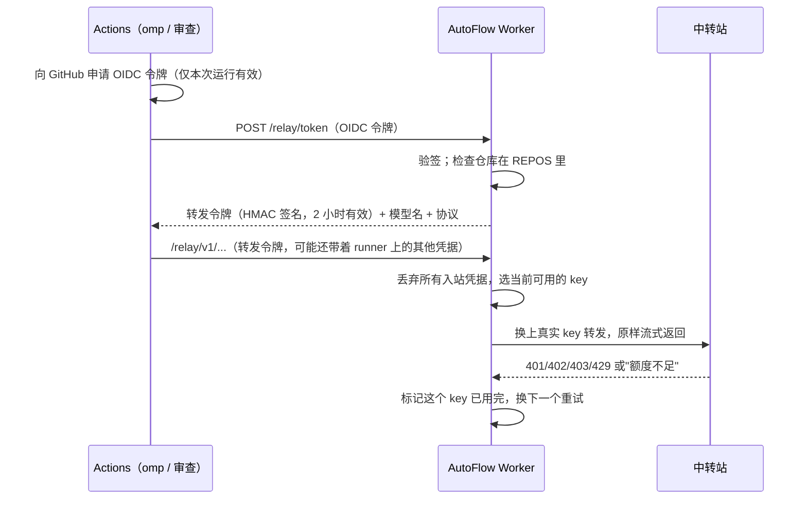

# 03 模型转发与 key 池

> 2026-10-24 草案，待确认。确认后替换 [01 §11](01-方案设计.md#11-模型-key-池)，`AI_KEYS` / `AI_MODEL` 从 GitHub 上移除。

## 1. 目标

- 模型 key 只存在 Cloudflare Worker 里。GitHub Actions 中的 omp 和审查都拿不到 key，只能拿到几分钟后就失效的转发令牌。
- 很多个小额度 key 按顺序使用：一个用完再换下一个，用完的 key 不会每次都被重试。
- 在 `/connect` 页面上配置中转地址、key 和模型，不用再改 GitHub secret。

## 2. 组成



## 3. 配置结构

在 `/connect` 页面新增一张卡片「模型」。配置分三层，地址和模型只写一次，key 挂在中转站下面：

```text
池 agent（协议：openai）
├─ 中转站 A   https://a.example.com/v1   模型 gpt-6.1-sol
│    ├─ sk-…1111
│    ├─ sk-…2222
│    └─ sk-…3333
└─ 中转站 B   https://b.example.com      模型 openai/gpt-6.1-sol
     └─ sk-…4444
```

| 层级   | 字段                      | 说明                                                                                                                                                                                                                                    |
| ------ | ------------------------- | --------------------------------------------------------------------------------------------------------------------------------------------------------------------------------------------------------------------------------------- |
| 池     | 名称、协议                | 名称如 `agent`、`review`，工作流和访问密钥按名称选池。协议为 `openai`（Chat Completions，ChatGPT 系和大部分中转站）或 `anthropic`（Messages，Claude Code 系中转站）。同一个池里的中转站必须支持这个协议，因为 Worker 只转发、不转换协议 |
| 中转站 | 名称、地址、模型 id、启用 | 同一个模型在不同中转站可能叫法不同，所以模型 id 写在中转站上。Worker 转发时，把请求里的模型名换成当前中转站的模型 id                                                                                                                    |
| key    | key、备注、启用           | 每个 key 有独立的"已用完"状态                                                                                                                                                                                                           |

- key 用 `SECRET_KEY` 加密后存在 KV，和飞书、电报的凭据一样。页面只显示 key 的后 4 位。
- 批量录入：在某个中转站下点「批量添加」，每行粘贴一个 key。同一个中转站里重复的 key 会自动跳过。

## 4. 用完换下一个

**选择**：池里的中转站从上到下排，每个中转站里的 key 也从上到下排。每个请求都从第一个中转站的第一个 key 开始，跳过已停用和"已用完"的，用第一个可用的。一个中转站的 key 全部用完，才换到下一个中转站（按顺序用，不轮询）。

**判定已用完**，满足任意一条：

- 中转站返回 401、402、403 或 429；
- 返回 400 或 5xx，并且错误内容里有额度类字样：`quota`、`insufficient`、`balance`、`billing`、`exceeded`、`额度`、`余额`、`用尽`、`不足`、`过期`。字样列表在页面上可以改。

**已用完之后**：

- 这个 key 记为"已用完"，带上原因和时间，同一个请求立刻换下一个 key 重试，omp 感知不到切换；
- 只在中转站还没开始返回内容时切换。流式内容已经开始发送后出错，就把错误原样交给 omp，由 omp 自己重试；
- 默认 24 小时后自动恢复，再试一次。如果中转站返回了 `Retry-After`，就按它给的时间恢复。页面上也可以手动「恢复」；
- 网络错误、超时、其他 4xx 不算用完：换下一个 key 重试一次，但不给这个 key 做标记。连续 3 次网络错误的中转站，跳过 5 分钟，避免整个中转站宕机时把每个 key 都试一遍。

**全部用完**：返回 429，错误里写明"模型池 `agent` 的 key 全部用完"，同时在已绑定的聊天里通知你一次（每个池每 6 小时最多通知一次）。

状态存在 KV 里，KV 是最终一致的，几个请求同时进来时，可能会有一两个请求再试一次已经用完的 key。这只多花一次请求，不会出错，所以不用更重的存储。

## 5. 页面

「模型」卡片上：

- 每个池按"中转站 → key"两层显示。中转站一行显示：名称、地址、模型、可用 key 数 / 总数；展开后显示每个 key 的后 4 位、备注、状态（可用 / 已用完·原因·恢复时间 / 已停用）；
- 中转站和 key 都可以新增、编辑、删除、上移、下移、停用；key 可以批量添加；
- 「测试」：中转站和单个 key 都有。中转站的测试用它的第一个可用 key 发一个最小请求，key 的测试只测这一个；结果显示能否连通、耗时和中转站返回的错误；
- 「恢复」：清除"已用完"标记；
- 顶部显示今天的请求数和切换次数，数据来自 KV 计数。
- 「访问密钥」区：新建、列出、吊销本地使用的密钥（见 §6）。

页面放在现有的管理登录后面（`ADMIN_TOKEN`），沿用现有的同源校验和 HttpOnly cookie。

## 6. 访问凭据

转发地址 `/relay/v1/*` 接受两种凭据，每种都只能使用它绑定的那一个池。

**GitHub Actions：转发令牌**

- **申请**：Actions 用 GitHub OIDC 申请令牌（job 需要 `id-token: write` 权限），`audience` 设为 Worker 地址。Worker 用 GitHub 的 JWKS 验签，并检查：`iss` 是 GitHub、`aud` 是本 Worker、`repository` 在 `REPOS` 里、`repository_owner` 是 `ouraihub`。
- **签发**：验证通过后，Worker 签发 `池名 + 仓库 + 过期时间` 的 HMAC 令牌，有效期 2 小时，覆盖一次 agent 运行的上限。
- omp 能读到这个令牌。最坏的情况是：它在 2 小时内被拿去花你的额度，但真实 key 拿不到；令牌过期后就没用了。

**本地 omp 和其他客户端：访问密钥**

- 在页面上新建，选好绑定的池，写一个备注（如"台式机 omp"）。密钥格式为 `afk_` 加随机串，只在创建时显示一次；Worker 只保存它的 SHA-256。
- 可以随时吊销，吊销后立即失效。页面上显示每个密钥的最后使用时间和今天的请求数。
- 本地 omp 在 `~/.omp/agent/models.yml` 里加一个 provider，`baseUrl` 指向 `https://<worker>/relay/v1`，`apiKey` 填访问密钥，`api` 按池的协议选择。页面上直接显示这段配置，复制就能用。
- 任何 OpenAI 或 Anthropic 兼容的客户端都可以这样接入，比如 AutoNote 的 AI 设置、Cherry Studio。

本地和 Actions 共用一个池时，额度和"已用完"状态也共用：本地用完的 key，Actions 也会跳过。

## 7. Actions 侧改动

- `agent.yml`：develop job 加 `id-token: write`；prepare 申请转发令牌，生成只有一个 provider 的 `models.yml`，`baseUrl` 指向 `https://<worker>/relay/v1`，`api` 按池的协议选择。omp 自带的多 provider 切换配置删掉，切换改由 Worker 负责。
- `review.yml`：审查改为请求同一个转发地址，池名用 `review`；`src/core/key-pool.ts` 和审查里的 key 切换逻辑删除。
- 新增输入 `relay_url`（Worker 地址）、`pool`（默认 `agent` / `review`）。
- 删除 secret `AI_KEYS`、variable `AI_MODEL`。项目只需要配 `AUTOFLOW_TOKEN`。

## 8. 部署

Worker 要正式部署到 Cloudflare：现在本机加临时隧道的方式，电脑关机后转发就断了。

- KV 命名空间 `AUTOFLOW`：首次部署时创建，把 `wrangler.jsonc` 里的 `REPLACE_ON_FIRST_DEPLOY` 换成真实 id；
- secrets：`GITHUB_TOKEN`、`SECRET_KEY`、`ADMIN_TOKEN`、`GITHUB_WEBHOOK_SECRET`，沿用 `.dev.vars` 里的值；
- 部署后：GitHub webhook 改到线上地址；在 `/connect` 重新连接飞书和电报（本地 KV 里的连接不会带到线上）；在「模型」卡片里录入 key。

Workers 按 CPU 时间计费，等待中转站返回的时间不算 CPU 时间，流式转发不受 30 秒限制。免费额度每天 10 万次请求，一次 agent 运行大约几十到几百次模型请求。

## 9. 测试与验收

- 单元测试：用完判定（各种状态码和错误字样）、按顺序选择和跳过、恢复时间、已开始返回后不切换、全部用完、OIDC 声明检查、令牌过期和池名限制。
- 本地冒烟：起两个假中转站，第一个返回"额度不足"，确认请求自动落到第二个、页面状态变成"已用完"，以及流式内容能完整到达。
- 线上验收：在 demo 仓库跑一次需求。
  - 在 Actions 日志和 runner 环境里搜不到任何真实 key；
  - 在页面上把第一个 key 换成一个已经用完的 key，确认流程不中断，页面显示切换记录。

## 10. 待你决定

1. 自动恢复时间默认 24 小时，可以吗？中转站的额度大多按天或按月重置。
2. 池默认建两个，`agent` 和 `review`，可以用不同的 key 和模型；还是只建一个，开发和审查共用？
